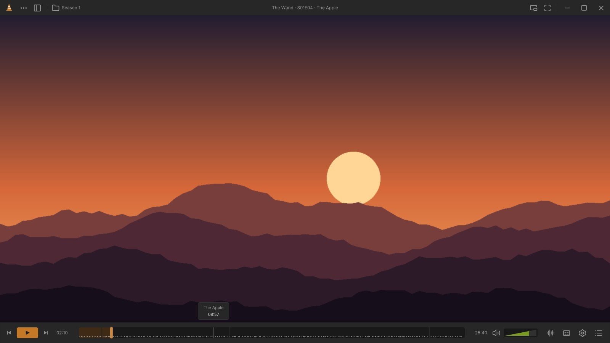
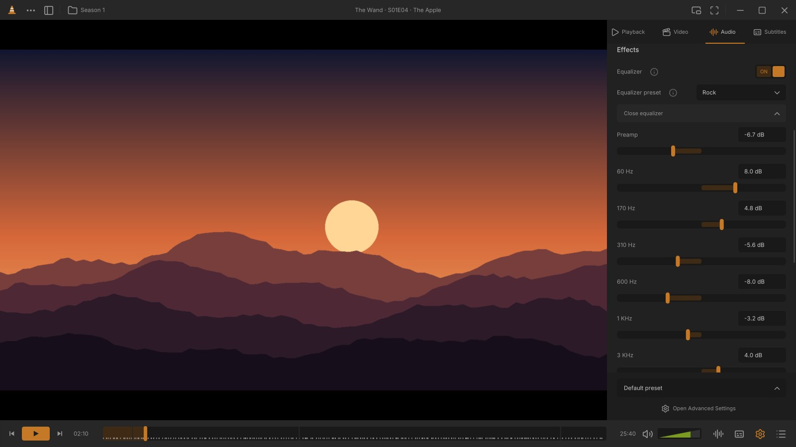
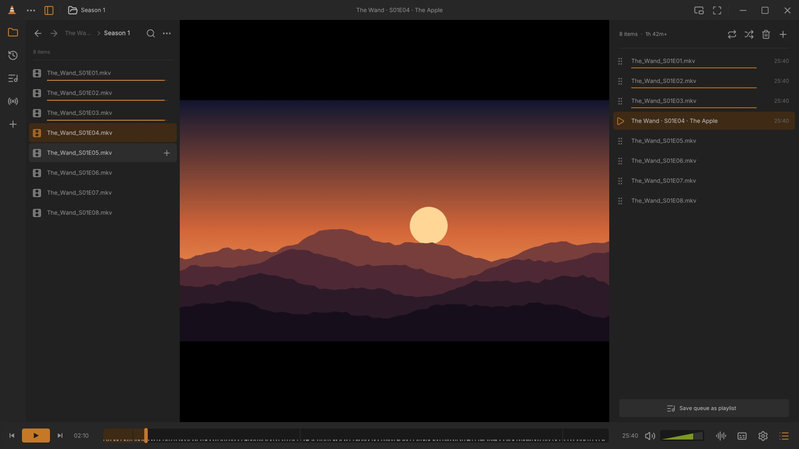
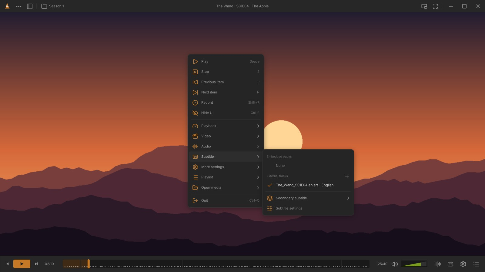
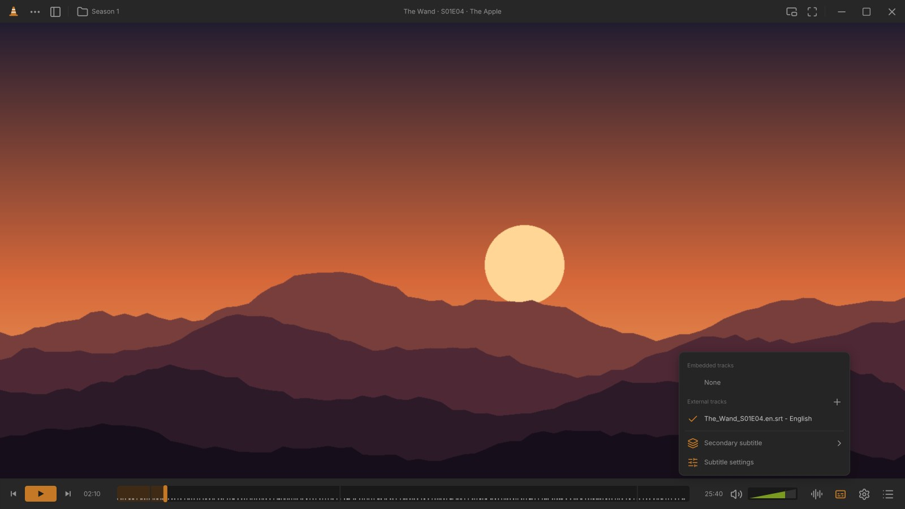
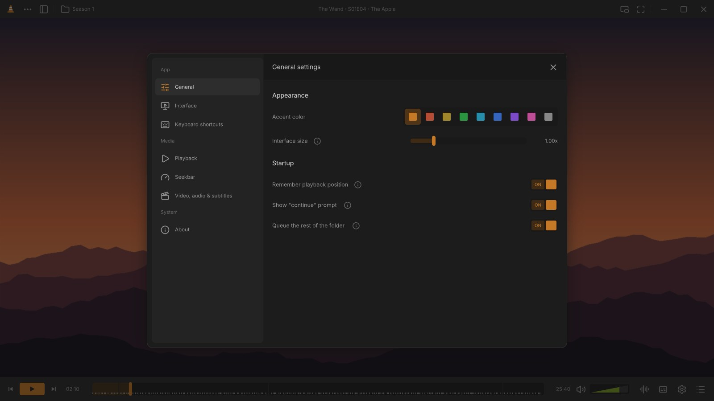
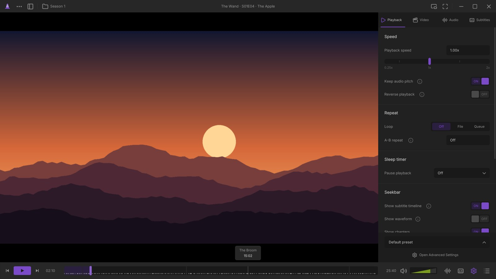
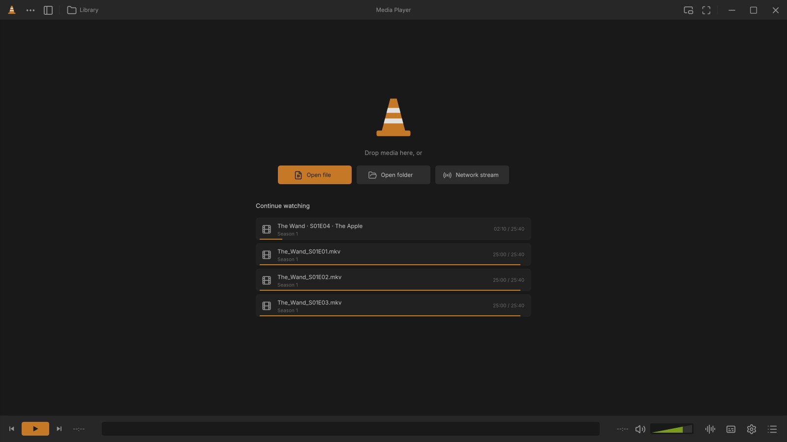

# mpv-vlc-redesign

An [mpv](https://mpv.io) setup that brings the **community VLC redesign** to life: the quiet,
rectangular, orange-cone interface from Juxtopposed's video
[“I Redesigned VLC After 25 Years”](https://www.youtube.com/watch?v=ERFeOgqk324)
and its [Figma community file](https://www.figma.com/community/file/1691465999134370980),
rebuilt as an mpv user script.



> Fan project. Not affiliated with VideoLAN or VLC. It is mpv underneath, so it plays everything mpv plays.

## What you get

Everything below follows the ideas from the video:

- **A thin, quiet control bar.** The play button stays on the left (no giant centered button), and the
  thick seekbar shows chapters, bookmarks, subtitle cues and an optional waveform. The **cone-shaped
  volume control** goes past 100%.
- **Top bar with the show's folder and the title**, plus fullscreen, mini player and window buttons.
  Both bars appear when you hover near them and disappear as soon as you move away, in fullscreen too.
- **Subtitle and audio buttons on the bottom right.** One click gives you the subtitle tracks (embedded +
  external, with **+** to add a file) or the audio tracks and **output device** (headphones / speakers).
- **A sidebar instead of the “Adjustments and Effects” window**, with four tabs:
  - **Playback**: speed slider, reverse playback, loop / A-B repeat, sleep timer, subtitle timeline &
    waveform on the seekbar, media info, **bookmarks** (Ctrl+B) and **chapters**.
  - **Video**: flip, rotate, zoom, aspect ratio, crop to fill, deinterlace, HDR tone mapping,
    brightness/contrast/saturation/gamma/hue, and filters (negate, grayscale, sepia, sharpen, denoise).
  - **Audio**: track, output device, volume, **audio delay slider**, 10-band **equalizer** with VLC's
    presets, compressor, normalization, stereo widening, mono.
  - **Subtitles**: track, secondary track, preferred language, **subtitle delay slider (−10 s … +10 s)**,
    subtitle speed, font, colors, bold, **relative or exact pixel sizes**, outline, background, position.
  - **Presets**: save the subtitle/audio sync and style as a preset *for this folder*, so every
    episode of a show opens with the same delay, track language and look.
- **Library without leaving the video**: click the folder name or the sidebar icon to browse the show's
  folder in a compact panel, with watched-progress bars. You also get Recent and saved Playlists.
  Click an episode to play the folder from there, or **+** to add it to the queue.
- **A real queue**: what plays next. Drag to reorder, x to remove, shuffle, repeat, and save it as a playlist.
  Opening one file automatically queues the rest of its folder, so the next episode just plays.
- **Cleaned-up right-click menu** with two-tone icons, shortcuts and a **Hide UI** option (Ctrl+\\).
- **Toasts show the key you pressed** (“`Ctrl+B` Bookmark added at 02:10”), so surprises are easy to undo.
- **“Continuing from 12:34 · Start over”** prompt next to the controls when a file resumes.
- **Home screen** with Open file / folder / network stream and “Continue watching”.
- **Settings window** with an **accent color picker** (orange, red, olive, green, teal, blue, purple, pink,
  gray), interface size, and a **keyboard shortcuts** page generated from your `input.conf`.

| | |
|---|---|
|  |  |
|  |  |
|  |  |
|  |  |

## Install

Requirements: **mpv 0.39 or newer** (tested with 0.41). Optional: `ffmpeg` (subtitle timeline for
embedded tracks, waveform), `zenity` or `kdialog` on Linux for file pickers.

### Linux / macOS

```sh
git clone https://github.com/<you>/mpv-vlc-redesign.git
cd mpv-vlc-redesign
./install.sh --thumbfast      # --thumbfast adds seekbar thumbnails (optional)
```

`install.sh` copies everything into `~/.config/mpv` and backs up an existing `mpv.conf` / `input.conf`
first. Use `./install.sh --link` to symlink instead, so `git pull` updates your install.

### Windows

Copy `mpv.conf`, `input.conf`, and the `scripts`, `script-opts` and `fonts` folders into
`%APPDATA%\mpv\` (or the `portable_config` folder next to `mpv.exe`).
For thumbnails, also put [thumbfast.lua](https://github.com/po5/thumbfast) in `scripts`.

### Uninstall

Delete `scripts/vlcui`, `script-opts/vlcui.conf`, the fonts, and restore your `*.bak-*` files.

## Keyboard shortcuts

VLC-style keys. Press **F1** in the player for the full list.

| Key | Action | Key | Action |
|---|---|---|---|
| Space | Play / pause | F / double-click | Fullscreen |
| ← / → | Jump 10 s (configurable) | Shift / Ctrl + ← → | 3 s / 1 min |
| ↑ / ↓, wheel | Volume | M | Mute |
| N / P | Next / previous item | S | Stop |
| [ / ] / = | Slower / faster / normal speed | E / , | Next / previous frame |
| G / H | Subtitle delay −/+ 50 ms | J / K | Audio delay −/+ 50 ms |
| V / B | Next subtitle / audio track | A / Z | Aspect ratio / zoom |
| L / Shift+L | Repeat mode / A-B repeat | R | Shuffle queue |
| Ctrl+B | Add bookmark | Ctrl+T | Jump to time |
| Ctrl+E | Playback/video/audio/subtitle sidebar | Ctrl+L | Queue |
| Ctrl+M | Library | Ctrl+P | Settings |
| Ctrl+\\ | Hide / show the interface | I | Media info |
| Ctrl+O / Ctrl+F | Open file / folder | Ctrl+N / Ctrl+V | Open URL / play clipboard |
| Shift+R | Record | Shift+S | Snapshot |
| Right-click | Menu | Ctrl+Q | Quit |

Change keys in `input.conf`. Every action is available as `script-binding vlcui/<name>`.

## Configuration

- **In the player**: Settings (Ctrl+P) holds the accent color, interface size, wheel behavior, toasts, the
  resume prompt, folder auto-queue and seekbar extras. These choices, plus presets, bookmarks and
  history, are saved in `~/.local/state/mpv/vlcui.json`.
- **`script-opts/vlcui.conf`**: defaults such as `scale`, `accent`, `hide_delay`, panel widths and
  `shrink_video` (move the video aside when a panel is open).
- **`mpv.conf`**: regular mpv options. `border=no` gives you the redesigned title bar with its own window
  buttons; set `border=yes` to keep your window manager's title bar (the buttons then hide automatically).
  Keep `osd-border-style` at its default. Script overlays inherit the OSD style, and `background-box`
  would draw boxes behind the interface.

## Project layout

```
mpv.conf, input.conf           mpv configuration (VLC-style keys)
script-opts/vlcui.conf         script defaults
scripts/vlcui/                 the interface (Lua)
  main.lua                     rendering, input, key bindings, events
  bars.lua                     top / bottom bars, seekbar, cone volume, track popovers
  sidebar.lua                  Playback / Video / Audio / Subtitles tabs + presets
  library.lua, queue.lua       library panel and queue panel
  settings.lua                 settings window and shortcut list
  menus.lua                    right-click menu, dropdowns, submenus
  media.lua                    tracks, filters, EQ, presets, bookmarks, history, dialogs
  ui.lua, draw.lua             widgets, ASS drawing, theme, icons
fonts/                         Inter + Lucide icon font (bundled)
```

## Credits

- Design: **Juxtopposed**, [video](https://www.youtube.com/watch?v=ERFeOgqk324) and
  [Figma file](https://www.figma.com/community/file/1691465999134370980).
- [mpv](https://mpv.io), the player underneath.
- Icons: [Lucide](https://lucide.dev) (ISC). Font: [Inter](https://rsms.me/inter/) (SIL OFL 1.1). Their
  licenses are in `licenses/`.
- Seekbar thumbnails: [thumbfast](https://github.com/po5/thumbfast) by po5 (optional, downloaded separately).

The code in this repository is released under the MIT license (see `LICENSE`).
